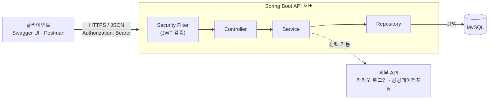
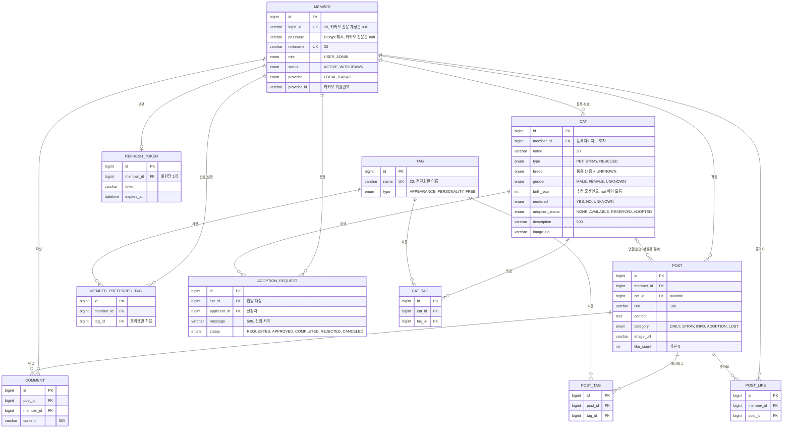
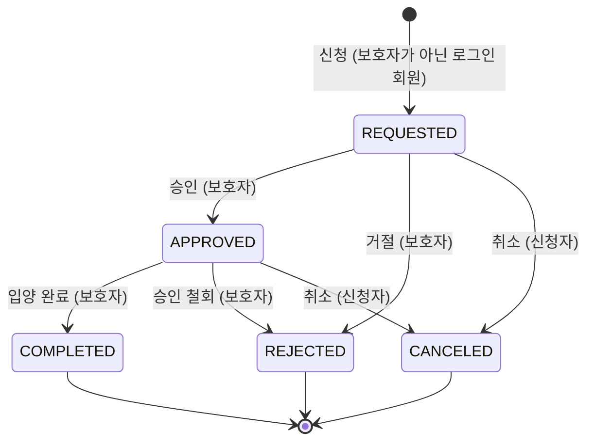
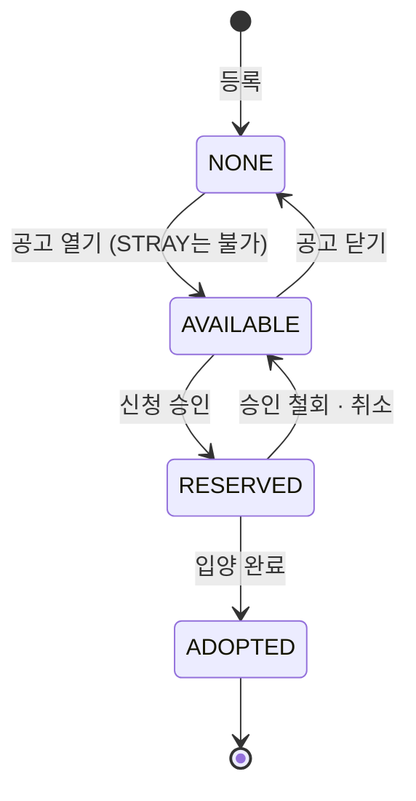

# 고양이 커뮤니티·입양 서비스

> 유기묘를 보호 중인 사람과 입양을 원하는 사람을 **태그 기반 추천**으로 이어 주고,
> 고양이를 키우는 사람들이 일상과 정보를 나누는 커뮤니티를 제공하는 **REST API 서버**입니다.


| 항목       | 내용                                                                    |
|------------|-------------------------------------------------------------------------|
| 프로젝트명 | NBE13-15-2-team02 (고양이 커뮤니티·입양 서비스)                         |
| 단계       | 2차 프로젝트 (2026-11-23 ~ 2026-12-08), 기능 동결 12/4, 발표 12/8       |
| 형태       | 화면 없는 REST API. Swagger UI와 Postman으로 호출 (웹 프론트엔드는 3차) |
| 문서       | 이 README, Swagger UI (`/swagger-ui/index.html`)                        |
| 기준일     | 2026-11-25, `dev` 브랜치 (PR #15까지 반영)                              |

> **구현 현황을 먼저 확인하세요.** 이 문서는 목표 설계 (명세서)와 현재 구현을 함께 담고 있습니다.
> 각 표의 ✅는 구현됨, 🚧는 예정입니다. 자세한 내용은 [구현 현황](#구현-현황)에 있습니다.

---

## 목차

1. [프로젝트 소개](#프로젝트-소개)
2. [주요 기능](#주요-기능)
3. [기술 스택](#기술-스택)
4. [시스템 구성](#시스템-구성)
5. [아키텍처](#아키텍처)
6. [ERD](#erd)
7. [도메인 규칙](#도메인-규칙)
8. [API 명세](#api-명세)
9. [공통 응답과 에러 처리](#공통-응답과-에러-처리)
10. [인증과 보안](#인증과-보안)
11. [시작하기](#시작하기)
12. [테스트](#테스트)
13. [협업 규칙](#협업-규칙)
14. [구현 현황](#구현-현황)
15. [로드맵](#로드맵)
16. [팀](#팀)
17. [참고 자료](#참고-자료)

---

## 프로젝트 소개

### 기획 배경

2025년 지방자치단체 동물보호센터에 구조된 고양이 **26,969마리 가운데 입양된 고양이는 7,721마리 (28.6%)** 입니다.
구조된 고양이 10마리 중 7마리가 새 가족을 만나지 못하는 이 격차가 서비스의 출발점입니다.

| 근거                           | 수치                                               | 서비스에 주는 의미                                                                          |
|--------------------------------|----------------------------------------------------|---------------------------------------------------------------------------------------------|
| 구조된 고양이의 입양률 (2025)  | 26,969마리 중 7,721마리, 28.6% (허프포스트코리아)  | 입양 희망자와 보호 중인 고양이를 잇는 통로가 더 필요합니다.                                 |
| 전체 유실·유기동물 구조 (2025) | 약 9만 6천 마리, 전년 대비 10.4% 감소 (머니투데이) | 줄고는 있지만 여전히 한 해 10만 마리에 가깝습니다.                                          |
| 반려묘 입양 경로 2위           | '길고양이를 데려다 키움' 29.3% (데일리벳)          | 개인이 직접 구조하는 경우가 많아, 개인 보호자가 직접 등록하는 구조가 맞습니다.              |
| 유기동물 입양 비율             | 8.8%, 전년 대비 3.4%P 감소 (데일리벳)              | 보호소 입양이 줄고 있어 다른 입양 경로가 필요합니다.                                        |
| 파양을 고려한 이유 1위         | 행동 문제 42.7% (데일리벳)                         | 입양 전에 성격이 맞는지 보는 것이 중요해, 추천에서 **성격 태그에 가장 큰 가중치**를 둡니다. |

> 출처: 농림축산식품부의 2025년 동물보호·복지 실태조사와 동물복지 국민의식조사 결과에 대한 언론 보도.

### 기존 서비스와의 차이

| 서비스                 | 하는 일                                                          | 이 서비스가 다른 점                                                                                                                                                                        |
|------------------------|------------------------------------------------------------------|--------------------------------------------------------------------------------------------------------------------------------------------------------------------------------------------|
| 포인핸드               | 전국 보호소의 유기동물 조회, 입양 방법 안내, 실종·보호·목격 신고 | 고양이만 다루고, 회원이 고른 **선호 태그에 맞는 고양이를 점수순으로 추천**합니다. 문의를 전화번호로 안내하는 대신 입양 신청·승인·완료를 **API로 처리해 진행 상태가 서비스 안에 남습니다.** |
| 국가동물보호정보시스템 | 시도·시군구 단위 구조동물 검색                                   | **개인 보호자가 구조한 고양이도 등록**할 수 있고, 커뮤니티 기능이 함께 있습니다.                                                                                                           |

### 사용자 유형

한 회원이 상황에 따라 여러 역할을 할 수 있습니다.

| 유형        | 누구인가                                                           | 원하는 것                                               |
|-------------|--------------------------------------------------------------------|---------------------------------------------------------|
| 입양 희망자 | 고양이를 처음 또는 추가로 입양하려는 사람                          | 내 생활과 성향에 맞는 고양이를 빠르게 찾기              |
| 보호자      | 길고양이를 구조해 임시 보호 중이거나, 반려묘의 새 가족을 찾는 사람 | 믿을 만한 입양자를 찾고 들어온 신청을 한곳에서 관리하기 |
| 집사        | 고양이를 키우는 일반 회원                                          | 일상 자랑, 정보 공유, 잃어버린 고양이 찾기              |

### 사용자 시나리오

**입양 희망자**

1. 회원가입 후 로그인하고, 마이페이지에서 선호 태그 (예: 개냥이, 얌전함, 장모)를 고릅니다.
2. 추천 목록에서 점수가 높은 고양이와, 자신의 선호와 **겹친 태그**를 확인합니다.
3. 마음에 드는 고양이에게 사유를 적어 입양을 신청합니다.
4. 보호자가 승인하면 만나서 인계받고, 보호자가 입양 완료로 처리합니다.

**보호자**

1. 구조한 고양이를 '임시 보호 (RESCUED)'로 등록하고 성격·외모 태그를 답니다.
2. 입양 공고를 엽니다. 이때부터 고양이가 추천 목록에 나옵니다.
3. 들어온 신청을 읽고 한 건을 승인합니다. 승인하면 고양이는 예약 상태가 되어 새 신청을 받지 않습니다.
4. 인계를 마치면 입양 완료로 처리하고, 남은 신청은 자동으로 거절됩니다.

**집사**

1. 반려묘를 등록하고 일상 카테고리에 글을 쓰고 해시태그를 답니다.
2. 다른 회원의 글에 좋아요와 댓글을 남기고, 고양이를 잃어버리면 분실 카테고리에 글을 올립니다.

---

## 주요 기능

### 2차 필수 (7개)

| 기능      | 내용                                                                                                      |
|-----------|-----------------------------------------------------------------------------------------------------------|
| 회원·인증 | 회원가입, 로그인(JWT), 토큰 재발급, 로그아웃, 내 정보 조회·수정·탈퇴                                      |
| 고양이    | 등록·조회·수정·삭제, 종류·품종·성별·태그 필터, 입양 공고 열기·닫기                                        |
| 태그      | 미리 정한 외모·성격 태그와 자유 태그, 회원별 선호 태그 설정                                               |
| 게시글    | 작성·조회·수정·삭제, 카테고리 5종(일상, 유기묘·길고양이, 정보 공유, 입양, 분실), 키워드·태그 검색, 좋아요 |
| 댓글      | 작성·조회·수정·삭제                                                                                       |
| 입양 신청 | 신청, 승인, 거절, 완료, 취소와 그에 따른 고양이 상태 변경                                                 |
| 추천      | 회원의 선호 태그와 고양이 태그가 겹치는 만큼 점수를 주고 점수순으로 추천 (성격 3점, 외모 2점)             |

### 2차 선택 / 3차

| 구분     | 내용                                                                                 |
|----------|--------------------------------------------------------------------------------------|
| 2차 선택 | 카카오 로그인, 댓글 좋아요, 대댓글, 팔로우, 구조동물 공공 API 연동, 테스트 코드 확대 |
| 3차      | 고양이 위치 공유(지도), 이미지 업로드, 행동·거리 기반 추천 가중치                    |

> 3차의 위치 공유는 길고양이의 정확한 좌표가 공개되면 학대에 악용될 수 있어, 동 단위로 흐리게 보여 주거나 로그인 회원에게만 공개하는 정책을 함께 설계합니다.

---

## 기술 스택

**Backend**  
    

**Database**  
 

**Security**  
 

**API Docs**  


**Build & Test**  
  

**Infra & Collaboration**  
  

> JWT는 의존성 (jjwt)과 설계는 갖춰져 있고 인증 필터는 구현 예정입니다. 자세한 구성은 [인증과 보안](#인증과-보안)을 참고하세요.

상세 버전과 용도는 아래 표와 같습니다.

| 구분       | 기술                                         | 비고                                          |
|------------|----------------------------------------------|-----------------------------------------------|
| 언어       | Java 21                                      | Gradle Toolchain으로 고정                     |
| 프레임워크 | Spring Boot 4.1.2                            | Spring MVC, Spring Data JPA, Bean Validation  |
| ORM        | Hibernate (JPA)                              | 엔티티 `BaseEntity` 상속, 감사(Auditing) 적용 |
| 보안       | Spring Security, jjwt 0.13.0                 | BCrypt 비밀번호 해시. JWT 인증은 구현 예정    |
| DB         | MySQL                                        | 로컬 개발은 `mysql:8.4` Docker 이미지로 검증  |
| API 문서   | springdoc-openapi 3.2.0                      | Swagger UI 자동 생성                          |
| 빌드       | Gradle (Wrapper)                             | `./gradlew`                                   |
| 테스트     | JUnit 5, AssertJ, Mockito, H2(테스트 런타임) | Spring Boot Test 스타터                       |
| 기타       | Lombok                                       |                                               |

---

## 시스템 구성

클라이언트, Spring Boot API 서버, MySQL의 3단 구조입니다. 외부 API는 Service만 호출하고, DB에는 Repository만 접근합니다.



| 구성 요소       | 기술                                                | 역할                                               |
|-----------------|-----------------------------------------------------|----------------------------------------------------|
| 클라이언트      | Swagger UI, Postman                                 | API 호출과 문서 확인. 3차에서 웹 프론트엔드로 교체 |
| API 서버        | Java, Spring Boot, Spring Security, Spring Data JPA | 인증, 요청 처리, 비즈니스 규칙                     |
| 데이터베이스    | MySQL                                               | 회원, 게시글, 고양이, 태그, 입양 신청 저장         |
| API 문서        | springdoc-openapi                                   | 코드에서 Swagger UI 문서를 자동 생성               |
| 외부 API (선택) | 카카오 로그인, 공공데이터포털                       | 소셜 로그인, 보호소 고양이 정보                    |

---

## 아키텍처

### 패키지 구조

도메인별로 최상위 패키지를 나누고, 각 패키지 안에서 계층 (`controller`, `service`, `repository`, `entity`, `dto`)을 나눕니다.
담당자와 패키지가 일대일로 맞아 서로의 파일을 건드릴 일이 줄어듭니다.

```
src/main/java/com/team02/catservice
├── Nbe13152Team02Application.java
├── global                      공통 코드
│   ├── config                  SecurityConfig, SwaggerConfig, JpaAuditingConfig
│   ├── security                SecurityUtil, TemporaryAuthFilter (JWT 필터는 예정)
│   ├── exception               ErrorCode, BusinessException, GlobalExceptionHandler
│   ├── response                ApiResponse, ErrorResponse, PageResponse
│   └── entity                  BaseEntity (id, createdAt, updatedAt)
├── auth                        인증
├── member                      회원
├── tag                         태그: Tag, TagType, MemberPreferredTag
├── cat                         고양이
│   ├── entity                  Cat, CatTag, CatType, Breed, Gender, Neutered, CatAdoptionStatus
│   └── event                   CatDeletionRequestedEvent, CatAdoptionClosedEvent, CatDeletedEvent
├── post                        게시글
│   ├── entity                  Post, PostTag, PostCategory
│   └── listener                PostEventListener
├── comment                     댓글 (예정)
└── adoption                    입양 신청과 추천
    ├── entity                  AdoptionRequest, AdoptionRequestStatus
    ├── repository              AdoptionRequestRepository
    ├── service                 RecommendationScorer
    ├── listener                AdoptionEventListener
    └── dto                     AdoptionCreateRequest, AdoptionResponse, RecommendedCatResponse, ScoringTag, ScoreResult
```

### 계층과 참조 규칙

- `controller`는 같은 패키지의 `service`만 호출하고, **엔티티 대신 DTO**를 돌려줍니다.
- 다른 패키지의 엔티티는 **연관관계 타입으로만** 쓰고, 조회와 변경은 그 패키지의 `service`를 거칩니다. **남의 repository는 주입하지 않습니다.**
- `/members/me/...` 컨트롤러는 `member`가 아니라 **그 데이터를 가진 패키지**에 둡니다. (예: 내가 쓴 글은 `post`)
- 순환 참조가 생기지 않도록 패키지 사이 참조는 아래 방향으로만 허용합니다.

| 패키지   | 참조해도 되는 패키지     |
|----------|--------------------------|
| global   | 없음                     |
| member   | global                   |
| auth     | global, member           |
| tag      | global, member           |
| cat      | global, member, tag      |
| post     | global, member, cat, tag |
| comment  | global, member, post     |
| adoption | global, member, cat, tag |

### 도메인 이벤트

`cat`은 `adoption`과 `post`를 참조할 수 없으므로 (위 표), **이벤트로 알립니다.**
`cat`이 `ApplicationEventPublisher`로 이벤트를 발행하고, 받는 쪽이 `@EventListener`로 처리합니다.
리스너는 발행한 쪽과 같은 스레드, 같은 트랜잭션에서 실행되어 **예외를 던지면 발행한 쪽의 작업도 함께 롤백**됩니다.

| 이벤트 (`cat/event`)               | 발행 시점           | 받는 쪽이 하는 일                                                              |
|------------------------------------|---------------------|--------------------------------------------------------------------------------|
| `CatDeletionRequestedEvent(catId)` | 고양이 삭제 전      | `adoption`: 진행 중 신청이 있으면 `INVALID_ADOPTION_STATUS`(409)로 삭제를 막음 |
| `CatAdoptionClosedEvent(catId)`    | 입양 공고를 닫을 때 | `adoption`: 남은 `REQUESTED` 신청을 모두 거절                                  |
| `CatDeletedEvent(catId)`           | 고양이 삭제 때      | `post`: 연결된 게시글의 `cat`을 null로                                         |

> 같은 방식으로 게시글 삭제 때 댓글을 지우는 일도 이벤트로 처리할 예정입니다. (`post` → `comment` 참조 금지)

---

## ERD

엔티티는 **11개**이고, 다대다 관계는 모두 **매핑 엔티티로 풉니다.** (`@ManyToMany`는 쓰지 않습니다.)
모든 테이블은 `BaseEntity`의 `id`(PK, Long), `created_at`, `updated_at`을 공통으로 가지며 아래 다이어그램에서는 생략했습니다.



### 테이블 설명

| 테이블                 | 용도                                              | 유니크 제약              | 구현                         |
|------------------------|---------------------------------------------------|--------------------------|------------------------------|
| `member`               | 회원. 탈퇴는 `status`만 변경하고 글과 댓글은 남김 | `login_id`, `nickname`   | ✅                           |
| `cat`                  | 고양이. 등록자가 보호자                           | -                        | ✅ (`member_id` 연결은 예정) |
| `tag`                  | 외모·성격 프리셋 태그와 자유 태그                 | `name`                   | ✅                           |
| `cat_tag`              | 고양이의 특징 태그 (매핑)                         | (`cat_id`, `tag_id`)     | ✅                           |
| `member_preferred_tag` | 추천에 쓰는 선호 태그 (매핑, 프리셋만 허용)       | (`member_id`, `tag_id`)  | ✅                           |
| `post`                 | 게시글. 입양·분실 글은 고양이 연결이 필수         | -                        | ✅                           |
| `post_tag`             | 게시글 해시태그 (매핑)                            | (`post_id`, `tag_id`)    | ✅                           |
| `post_like`            | 게시글 좋아요 (매핑)                              | (`member_id`, `post_id`) | 🚧                           |
| `comment`              | 댓글                                              | -                        | 🚧                           |
| `adoption_request`     | 입양 신청. 신청 한 건의 진행 상태를 보관          | -                        | ✅                           |
| `refresh_token`        | Refresh Token. 재발급 때 교체, 로그아웃 때 삭제   | `member_id`              | 🚧                           |

### 설계 결정

- **품종은 `cat.breed`로만 관리**하고 태그로 중복 저장하지 않습니다.
- **태그는 3종류**입니다. `APPEARANCE`(외모)와 `PERSONALITY`(성격)는 시드 데이터로 넣는 프리셋이고, `FREE`(자유)는 글이나 고양이를 등록할 때 자동으로 생깁니다. 선호 태그는
  프리셋만 허용합니다.
- **태그 규칙:** 저장 전에 정규화 (앞의 `#`과 공백 제거, 영문 소문자)하고, 길이는 1~20자, 글이나 고양이 하나에 최대 10개입니다. 없는 이름이면 `FREE`로 새로 만들고 있으면 재사용합니다.
- **모르는 값은 `UNKNOWN`** 입니다. `breed`, `gender`, `neutered`가 해당하고, `birth_year`는 null이면 '모름'이며 응답에서 `age`로 계산합니다. 공공데이터포털
  구조동물 조회 서비스의 '미상'을 포함한 3개 값 방식을 따랐습니다.
- **길고양이 (`STRAY`)는 입양 공고를 열 수 없습니다.** 구조한 뒤 `type`을 `RESCUED`로 바꿔야 `AVAILABLE`이 됩니다.
- **상태는 문자열 enum**(`EnumType.STRING`)으로 저장해, enum 순서가 바뀌어도 데이터가 어긋나지 않게 했습니다.
- **연관관계는 모두 `LAZY`** 이고, 목록 조회의 N+1은 `@EntityGraph`나 fetch join으로 막습니다.

### 삭제 규칙

| 대상        | 규칙                                                                                                         |
|-------------|--------------------------------------------------------------------------------------------------------------|
| 회원 탈퇴   | `status`만 `WITHDRAWN`으로 변경. 글과 댓글은 남기고 작성자를 '탈퇴한 회원'으로 표시                          |
| 게시글 삭제 | 댓글, 좋아요, 태그 매핑을 함께 삭제                                                                          |
| 고양이 삭제 | 진행 중(`REQUESTED`, `APPROVED`) 신청이 있으면 삭제 불가(409). 삭제할 때 연결된 게시글의 `cat`은 null로 변경 |

---

## 도메인 규칙

### 입양 상태는 두 군데에 있습니다

| 구분             | 위치                     | 값                                                                                   | 관리하는 곳 |
|------------------|--------------------------|--------------------------------------------------------------------------------------|-------------|
| 고양이 입양 상태 | `Cat.adoptionStatus`     | `NONE`(대상 아님), `AVAILABLE`(입양 가능), `RESERVED`(진행 중), `ADOPTED`(입양 완료) | `cat`       |
| 신청 상태        | `AdoptionRequest.status` | `REQUESTED`, `APPROVED`, `COMPLETED`, `REJECTED`, `CANCELED`                         | `adoption`  |

한 번의 행동이 **두 상태를 함께 바꿉니다.** 입양 서비스가 하나의 트랜잭션 안에서 신청 상태를 바꾸고, 고양이 상태는 `cat` 쪽 서비스를 통해 바꿉니다.

### 입양 신청 상태 전이

신청은 `REQUESTED`에서 시작해 `COMPLETED`, `REJECTED`, `CANCELED` 중 하나로 끝납니다. 보호자는 승인·거절·완료를, 신청자는 취소만 할 수 있습니다.



| 행동 | 누가                      | 신청 상태                            | 고양이 상태                    | 조건과 추가 처리                                           |
|------|---------------------------|--------------------------------------|--------------------------------|------------------------------------------------------------|
| 신청 | 보호자가 아닌 로그인 회원 | 새로 `REQUESTED`                     | 변화 없음                      | 고양이가 `AVAILABLE`, 같은 고양이에 내 진행 중 신청이 없음 |
| 승인 | 보호자                    | `REQUESTED` → `APPROVED`             | `AVAILABLE` → `RESERVED`       | 고양이 하나에 `APPROVED`는 1건                             |
| 거절 | 보호자                    | `REQUESTED`, `APPROVED` → `REJECTED` | `RESERVED`였다면 `AVAILABLE`로 | 승인 뒤에도 가능(승인 철회)                                |
| 완료 | 보호자                    | `APPROVED` → `COMPLETED`             | `RESERVED` → `ADOPTED`         | 남은 `REQUESTED`는 모두 `REJECTED`                         |
| 취소 | 신청자                    | `REQUESTED`, `APPROVED` → `CANCELED` | `RESERVED`였다면 `AVAILABLE`로 | 입양 완료 뒤에는 불가                                      |

- 표에 없는 전이는 **409 `INVALID_ADOPTION_STATUS`** 로 막습니다. 이 규칙은 `AdoptionRequestStatus` enum 안에 있고, 엔티티에는 setter를 두지 않아 **전이
  메서드를 거치지 않고는 상태를 바꿀 수 없습니다.**
- 보호자가 공고를 닫으면 (`AVAILABLE` → `NONE`) 남은 `REQUESTED`는 모두 `REJECTED`가 됩니다. `RESERVED` 상태에서는 공고를 닫을 수 없습니다.
- "진행 중"은 `REQUESTED`, `APPROVED`입니다.

### 고양이 입양 상태 전이



### 추천 알고리즘

추천 점수는 회원의 선호 태그와 고양이 태그가 **겹치는 개수에 가중치를 곱한 합**입니다. 성격 태그가 외모 태그보다 무겁습니다.

```
score(고양이) = 3 × |성격 태그 겹침| + 2 × |외모 태그 겹침|
```

- 후보는 `adoptionStatus`가 `AVAILABLE`인 고양이이고, 내가 등록한 고양이와 내가 이미 신청한 고양이는 뺍니다.
- 점수가 높은 순, 같으면 최근 등록순으로 정렬해 `size`개 (기본 10)를 돌려줍니다.
- 선호 태그가 없는 회원에게는 최근 등록순으로 돌려주고 `message`로 선호 태그 설정을 안내합니다.
- 이름과 종류가 **모두 같은** 태그만 겹친 것으로 봅니다. 자유 태그는 점수에 반영하지 않습니다.
- 가중치 (3, 2)는 상수로 분리해, 3차에서 행동·거리 가중치를 더하기 쉽게 했습니다.

선호 태그가 `개냥이`, `얌전함`(성격), `장모`(외모)인 회원의 계산 예입니다.

| 고양이 | 태그                 | 겹치는 태그    | 점수          |
|--------|----------------------|----------------|---------------|
| 나비   | 개냥이, 얌전함, 단모 | 개냥이, 얌전함 | 3 + 3 = **6** |
| 치즈   | 개냥이, 장모, 치즈   | 개냥이, 장모   | 3 + 2 = **5** |
| 까미   | 장모, 턱시도, 활발함 | 장모           | **2**         |

응답에는 `score`와 `matchedTags`를 넣어 추천 이유를 보여 줍니다.

```json
{
  "status": 200,
  "message": "추천 고양이 목록을 조회했습니다.",
  "data": [
    {
      "catId": 12,
      "name": "나비",
      "score": 6,
      "matchedTags": [
        "개냥이",
        "얌전함"
      ]
    },
    {
      "catId": 7,
      "name": "치즈",
      "score": 5,
      "matchedTags": [
        "개냥이",
        "장모"
      ]
    }
  ]
}
```

> 2차에서는 후보와 태그를 한 번에 조회해 자바 코드로 점수를 계산합니다. 고양이 수가 크게 늘면 후보를 DB에서 먼저 줄이고 (입양 가능, 내 고양이 제외, 선호 태그가 하나라도 겹치는 고양이), 필요하면
> DB에서 점수를 계산해 상위 N개만 가져오는 방식으로 확장합니다.

---

## API 명세

모든 API는 `/api/v1` 아래에 있습니다. 필수 엔드포인트는 **39개**이고, 아래 표의 경로는 `/api/v1`을 생략했습니다.
권한의 '본인'은 작성자나 등록자를 뜻합니다. 상태의 ✅는 구현됨, 🚧는 예정입니다.

### Auth

| 메서드 | 경로            | 설명                              | 권한          | 상태 |
|--------|-----------------|-----------------------------------|---------------|------|
| POST   | `/auth/signup`  | 회원가입                          | 공개          | ✅   |
| POST   | `/auth/login`   | 로그인, Access·Refresh Token 발급 | 공개          | 🚧   |
| POST   | `/auth/reissue` | Access Token 재발급               | Refresh Token | 🚧   |
| POST   | `/auth/logout`  | 로그아웃 (Refresh Token 삭제)     | 로그인        | 🚧   |

### Member

| 메서드 | 경로                  | 설명                  | 권한   | 상태 |
|--------|-----------------------|-----------------------|--------|------|
| GET    | `/members/me`         | 내 정보 조회          | 로그인 | 🚧   |
| PATCH  | `/members/me`         | 닉네임·비밀번호 수정  | 로그인 | 🚧   |
| DELETE | `/members/me`         | 탈퇴                  | 로그인 | 🚧   |
| GET    | `/members/{memberId}` | 다른 회원 프로필 조회 | 공개   | 🚧   |

### Post

| 메서드 | 경로                    | 설명                                                                | 권한   | 상태 |
|--------|-------------------------|---------------------------------------------------------------------|--------|------|
| POST   | `/posts`                | 글 작성                                                             | 로그인 | 🚧   |
| GET    | `/posts`                | 목록 조회 (`category`, `keyword`, `tag` 필터, `sort`: latest·likes) | 공개   | 🚧   |
| GET    | `/posts/{postId}`       | 상세 조회                                                           | 공개   | 🚧   |
| PATCH  | `/posts/{postId}`       | 수정                                                                | 본인   | 🚧   |
| DELETE | `/posts/{postId}`       | 삭제                                                                | 본인   | 🚧   |
| POST   | `/posts/{postId}/likes` | 좋아요                                                              | 로그인 | 🚧   |
| DELETE | `/posts/{postId}/likes` | 좋아요 취소                                                         | 로그인 | 🚧   |
| GET    | `/members/me/posts`     | 내가 쓴 글                                                          | 로그인 | 🚧   |

### Comment

| 메서드 | 경로                       | 설명      | 권한   | 상태 |
|--------|----------------------------|-----------|--------|------|
| POST   | `/posts/{postId}/comments` | 댓글 작성 | 로그인 | 🚧   |
| GET    | `/posts/{postId}/comments` | 댓글 목록 | 공개   | 🚧   |
| PATCH  | `/comments/{commentId}`    | 수정      | 본인   | 🚧   |
| DELETE | `/comments/{commentId}`    | 삭제      | 본인   | 🚧   |

### Cat

| 메서드 | 경로                            | 설명                                                                | 권한   | 상태 |
|--------|---------------------------------|---------------------------------------------------------------------|--------|------|
| POST   | `/cats`                         | 고양이 등록                                                         | 로그인 | 🚧   |
| GET    | `/cats`                         | 목록 조회 (`type`, `adoptionStatus`, `breed`, `gender`, `tag` 필터) | 공개   | 🚧   |
| GET    | `/cats/{catId}`                 | 상세 조회                                                           | 공개   | 🚧   |
| PATCH  | `/cats/{catId}`                 | 수정                                                                | 본인   | 🚧   |
| DELETE | `/cats/{catId}`                 | 삭제                                                                | 본인   | 🚧   |
| PATCH  | `/cats/{catId}/adoption-status` | 입양 공고 열기·닫기 (`NONE` ↔ `AVAILABLE`)                          | 본인   | 🚧   |
| GET    | `/members/me/cats`              | 내가 등록한 고양이                                                  | 로그인 | 🚧   |

### Tag

| 메서드 | 경로                         | 설명                               | 권한   | 상태 |
|--------|------------------------------|------------------------------------|--------|------|
| GET    | `/tags`                      | 태그 목록 (`type`, `keyword` 필터) | 공개   | 🚧   |
| GET    | `/members/me/preferred-tags` | 내 선호 태그 조회                  | 로그인 | 🚧   |
| PUT    | `/members/me/preferred-tags` | 선호 태그 전체 교체 (`tagIds`)     | 로그인 | 🚧   |

### Adoption

| 메서드 | 경로                               | 설명                           | 권한          | 상태 |
|--------|------------------------------------|--------------------------------|---------------|------|
| POST   | `/adoptions`                       | 입양 신청 (`catId`, `message`) | 로그인        | 🚧   |
| GET    | `/adoptions/{adoptionId}`          | 신청 상세                      | 신청자·보호자 | 🚧   |
| GET    | `/members/me/adoptions`            | 내가 보낸 신청                 | 로그인        | 🚧   |
| GET    | `/members/me/adoptions/received`   | 내 고양이에 들어온 신청        | 로그인        | 🚧   |
| PATCH  | `/adoptions/{adoptionId}/approve`  | 승인                           | 보호자        | 🚧   |
| PATCH  | `/adoptions/{adoptionId}/reject`   | 거절                           | 보호자        | 🚧   |
| PATCH  | `/adoptions/{adoptionId}/complete` | 입양 완료 처리                 | 보호자        | 🚧   |
| PATCH  | `/adoptions/{adoptionId}/cancel`   | 취소                           | 신청자        | 🚧   |
| GET    | `/adoptions/recommendations`       | 추천 고양이 목록               | 로그인        | 🚧   |

### 선택 기능 API

| 메서드       | 경로                          | 설명                                      |
|--------------|-------------------------------|-------------------------------------------|
| POST         | `/auth/kakao`                 | 카카오 인가 코드를 받아 서비스의 JWT 발급 |
| POST, DELETE | `/comments/{commentId}/likes` | 댓글 좋아요, 취소                         |
| POST, DELETE | `/members/{memberId}/follow`  | 팔로우, 언팔로우                          |

### 요청 예시: 고양이 등록

`tags`는 이름으로 받습니다. 프리셋에 없는 `밥을 빨리먹음`은 정규화되어 `밥을빨리먹음`이라는 `FREE` 태그로 저장됩니다.

```json
{
  "name": "나비",
  "type": "RESCUED",
  "breed": "KOREAN_SHORTHAIR",
  "gender": "FEMALE",
  "birthYear": 2024,
  "neutered": "UNKNOWN",
  "description": "아파트 화단에서 구조했어요.",
  "tags": [
    "단모",
    "치즈",
    "개냥이",
    "밥을 빨리먹음"
  ]
}
```

---

## 공통 응답과 에러 처리

성공과 실패 응답을 각각 한 가지 모양으로 통일합니다. (공공데이터포털 API의 XML 기본 응답, 줄임 파라미터 같은 불편함을 반복하지 않기 위해 모든 응답은 JSON 한 형식이고, 파라미터는 `category`,
`keyword`처럼 풀어 씁니다.)

**성공**

```json
{
  "status": 200,
  "message": "게시글을 조회했습니다.",
  "data": {
    "postId": 1,
    "title": "우리집 치즈 자랑"
  }
}
```

**실패** (`error`에는 에러 코드를 넣습니다)

```json
{
  "status": 404,
  "error": "POST_NOT_FOUND",
  "message": "게시글을 찾을 수 없습니다.",
  "timestamp": "2026-11-23T12:00:00"
}
```

**목록 응답**의 `data`는 `content`, `page`, `size`, `totalElements`, `totalPages`로 고정합니다.
요청 파라미터는 `page`(0부터), `size`(기본 10, 최대 50), `sort`입니다.

**상태 코드:** 성공은 `200`(조회·수정·삭제)과 `201`(생성)만 씁니다. 삭제도 `204` 대신 `200`과 메시지를 돌려줘 응답 모양을 유지합니다.

| 상태 | 쓰는 경우                       | 에러 코드                                                                                                                      |
|------|---------------------------------|--------------------------------------------------------------------------------------------------------------------------------|
| 400  | 입력값 검증 실패                | `INVALID_INPUT`, `INVALID_TAG`, `TAG_LIMIT_EXCEEDED`, `CAT_REQUIRED`                                                           |
| 401  | 토큰이 없거나 만료됨            | `UNAUTHORIZED`, `TOKEN_EXPIRED`, `INVALID_TOKEN`, `LOGIN_FAILED`                                                               |
| 403  | 본인 것이 아닌 자원을 수정·삭제 | `FORBIDDEN`                                                                                                                    |
| 404  | 대상이 없음                     | `NOT_FOUND`, `MEMBER_NOT_FOUND`, `POST_NOT_FOUND`, `COMMENT_NOT_FOUND`, `CAT_NOT_FOUND`, `TAG_NOT_FOUND`, `ADOPTION_NOT_FOUND` |
| 405  | 지원하지 않는 메서드            | `METHOD_NOT_ALLOWED`                                                                                                           |
| 409  | 중복이나 상태 충돌              | `DUPLICATE_LOGIN_ID`, `DUPLICATE_NICKNAME`, `ALREADY_LIKED`, `INVALID_ADOPTION_STATUS`                                         |
| 500  | 예상하지 못한 서버 오류         | `INTERNAL_SERVER_ERROR`                                                                                                        |

도메인 오류는 `BusinessException(ErrorCode)`를 던지고, `GlobalExceptionHandler`가 위 형식으로 변환합니다.
입력 검증 실패 (Bean Validation)와 잘못된 요청 본문도 같은 형식의 400으로 응답합니다.

---

## 인증과 보안

| 항목         | 방식                                                                              | 상태 |
|--------------|-----------------------------------------------------------------------------------|------|
| 로그인       | 아이디와 비밀번호를 확인한 뒤 Access Token(30분)과 Refresh Token(14일) 발급       | 🚧   |
| 요청 인증    | `Authorization: Bearer` 헤더의 Access Token을 필터에서 검증                       | 🚧   |
| 토큰 재발급  | Refresh Token을 DB에 저장하고 재발급할 때마다 새 값으로 교체, 로그아웃하면 삭제   | 🚧   |
| 비밀번호     | BCrypt로 해시해 저장 (비밀번호는 영문, 숫자, 특수문자 8~72자)                     | ✅   |
| 입력 검증    | Bean Validation으로 요청 값을 검증하고 실패하면 400                               | ✅   |
| 비밀 값      | JWT 서명 키, DB 비밀번호, 외부 API 키는 환경 변수로 주입하고 저장소에 올리지 않음 | ✅   |
| 401·403 응답 | `AuthenticationEntryPoint`, `AccessDeniedHandler`에서 같은 에러 포맷으로 응답     | 🚧   |

**권한은 '누구의 것인가'로 나눕니다.**

| 요청                           | 허용 대상          |
|--------------------------------|--------------------|
| 게시글·댓글·고양이·태그 조회   | 누구나             |
| 작성, 좋아요, 입양 신청        | 로그인한 회원      |
| 게시글·댓글·고양이 수정과 삭제 | 작성자 본인        |
| 입양 신청 조회                 | 신청자와 보호자    |
| 입양 승인, 거절, 완료          | 그 고양이의 보호자 |
| 입양 신청 취소                 | 신청자             |

> **현재는 JWT 인증이 구현되기 전이라 개발용 임시 인증을 씁니다.**
> `TemporaryAuthFilter`가 모든 요청을 **회원 ID 1**로 인증하고, `X-Dev-Member-Id` 헤더로 다른 회원 ID를 흉내 낼 수 있습니다.
> `SecurityConfig`도 임시로 전체 허용 상태입니다. **JWT 필터 적용 시 이 둘을 교체해야 하며, 이 상태로 배포해서는 안 됩니다.**
> 로그인한 회원 ID는 코드에서 항상 `SecurityUtil.getCurrentMemberId()`로 꺼냅니다.

---

## 시작하기

### 사전 준비

- JDK 21
- Docker (로컬 MySQL용) 또는 직접 설치한 MySQL
- Git

### 1. 저장소 받기

```bash
git clone https://github.com/prgrms-be-devcourse/NBE13-15-2-team02.git
cd NBE13-15-2-team02
git checkout dev
```

### 2. MySQL 준비

```bash
docker run -d --name catservice-mysql \
  -p 3306:3306 \
  -e MYSQL_DATABASE=catservice \
  -e MYSQL_USER=<사용자> \
  -e MYSQL_PASSWORD=<비밀번호> \
  -e MYSQL_ROOT_PASSWORD=<루트 비밀번호> \
  -e TZ=Asia/Seoul \
  mysql:8.4 \
  --character-set-server=utf8mb4 --collation-server=utf8mb4_unicode_ci --default-time-zone=+09:00
```

컨테이너를 껐다 켤 때는 `docker stop catservice-mysql`, `docker start catservice-mysql`을 씁니다. 데이터는 컨테이너를 지워도 볼륨에 남습니다.

### 3. `.env` 만들기

프로젝트 **루트**에 `.env` 파일을 만듭니다. (`.gitignore`에 등록되어 저장소에 올라가지 않습니다.)
저장소의 `.env.example`을 복사해서 시작하면 편합니다.

```bash
cp .env.example .env
```

복사한 뒤 아래 값을 환경에 맞게 채웁니다.

```properties
DB_URL=jdbc:mysql://localhost:3306/catservice?serverTimezone=Asia/Seoul&characterEncoding=UTF-8
DB_USERNAME=<사용자>
DB_PASSWORD=<비밀번호>
JWT_SECRET=<32자 이상의 임의 문자열>
```

| 변수                         | 설명                                  |
|------------------------------|---------------------------------------|
| `DB_URL`                     | JDBC 접속 주소                        |
| `DB_USERNAME`, `DB_PASSWORD` | DB 계정                               |
| `JWT_SECRET`                 | JWT 서명 키. HS256 기준 32바이트 이상 |

- **값에 따옴표를 쓰지 마세요.** 값 전체가 그대로 읽혀서 따옴표까지 값에 포함됩니다.
- `application.yaml`의 `spring.config.import: optional:file:.env[.properties]`가 이 파일을 읽습니다. `.env`가 없어도 앱은 뜨지만 값이 비어 접속에
  실패하며, 환경 변수로 직접 주입하는 방식도 그대로 동작합니다.
- 실행 위치 (Working directory)가 프로젝트 루트여야 `.env`를 찾습니다. (IntelliJ 기본값)

### 4. 실행

```bash
./gradlew bootRun
```

테이블은 앱이 시작할 때 자동으로 만들어집니다. (`spring.jpa.hibernate.ddl-auto: update`, 개발용 설정이며 운영에서는 `validate` 또는 마이그레이션 도구로 전환 예정)

### 5. API 문서 확인

| 용도               | 주소                                        |
|--------------------|---------------------------------------------|
| Swagger UI         | http://localhost:8080/swagger-ui/index.html |
| OpenAPI 명세(JSON) | http://localhost:8080/v3/api-docs           |

### 개발용 데이터

- 앱이 시작될 때 회원이 한 명도 없으면 `MemberSeedRunner`가 **테스트 회원 2명**(id 1, 2)을 만듭니다. (개발 전용, 계정 정보는 `MemberSeedRunner` 참고)
- 임시 인증의 기본 회원이 id 1이므로 앱 실행 직후부터 로그인 필요 API를 호출할 수 있고, 다른 사람 입장은 `X-Dev-Member-Id: 2` 헤더로 흉내 냅니다.

### 자주 겪는 문제

| 증상                                                                    | 원인                                        | 해결                                                                 |
|-------------------------------------------------------------------------|---------------------------------------------|----------------------------------------------------------------------|
| `'url' must start with "jdbc"`                                          | `.env`를 못 읽어 `DB_URL`이 비어 있음       | `.env` 위치(프로젝트 루트)와 실행 위치 확인                          |
| `Connection refused`                                                    | DB가 꺼져 있거나 포트가 다름                | `docker ps`로 컨테이너 확인, `DB_URL`의 포트 확인                    |
| `Access denied for user`                                                | 사용자나 비밀번호 불일치                    | `.env`와 컨테이너를 만들 때의 값을 맞춤                              |
| `Public Key Retrieval is not allowed`                                   | MySQL 8의 인증 방식                         | `DB_URL` 끝에 `&allowPublicKeyRetrieval=true&useSSL=false` 추가      |
| `Port 8080 was already in use`                                          | 이미 실행 중인 앱이 있음                    | 실행 중인 앱을 종료                                                  |
| 엔티티를 추가한 뒤 기동 실패 (`Attribute 'id' is declared as an '@Id'`) | `BaseEntity`가 이미 가진 `id`를 다시 선언함 | 엔티티에서 `id` 필드 선언을 삭제 (컴파일은 되고 **실행해야** 드러남) |

---

## 테스트

```bash
./gradlew test                                          # 전체
./gradlew test --tests '*AdoptionRequestStatusTest'    # 특정 클래스
```

- 전체 테스트에는 앱 컨텍스트를 띄우는 `contextLoads` 테스트가 있어, **DB와 `.env`가 준비된 상태**에서 실행해야 합니다.
- **컴파일 통과가 앱 기동을 보장하지 않습니다.** JPA 매핑 오류는 앱을 실행해야 드러나므로, 엔티티를 추가한 PR은 앱 기동까지 확인합니다.

| 테스트                           | 개수 | 무엇을 검증하나                                                                         |
|----------------------------------|------|-----------------------------------------------------------------------------------------|
| `AdoptionRequestStatusTest`      | 28   | 입양 신청 상태 전이: 허용된 전이, 허용되지 않은 전이, 끝난 상태, 진행 중 판별           |
| `RecommendationScorerTest`       | 11   | 추천 점수: 명세서 계산 예, 가중치, 경계 케이스(겹침 없음, 빈 태그, 같은 이름·다른 종류) |
| `AdoptionEventListenerTest`      | 5    | 이벤트 리스너: 삭제 막기, 남은 신청 거절 (Mockito)                                      |
| `Nbe13152Team02ApplicationTests` | 1    | 앱 컨텍스트 로딩                                                                        |

단위 테스트는 스프링 없이 JUnit과 Mockito로 작성해 DB 없이 빠르게 돕니다.
다만 단위 테스트는 `@EventListener`가 실제로 등록됐는지는 확인하지 못하므로, 이벤트를 발행하는 쪽이 올라오면 앱을 띄워서 연결도 확인합니다.

---

## 협업 규칙

### 브랜치 전략

```
main  ◀── (기능 동결 후, 발표 직전에만)
  ▲
dev   ◀── feat/*, fix/*, chore/*  (작업별 브랜치, PR로 통합)
```

- 작업별 브랜치를 **`dev`에서 따고, PR도 `dev`로** 보냅니다. `dev` → `main`은 12/4 기능 동결 후와 12/8 발표 직전에만 합칩니다.
- `dev`에 PR을 올릴 때는 **승인 리뷰가 1개 이상** 있어야 머지됩니다.
- 머지된 브랜치는 재사용하지 않고, 새 작업은 최신 `dev`를 받아 새 브랜치에서 시작합니다.
- 작업 시작 전과 PR 전에 `dev`를 받아 (`git pull origin dev`) 충돌을 줄입니다.

### 커밋 메시지

`접두사: 내용` 형식을 씁니다.

| 접두사     | 용도                       |
|------------|----------------------------|
| `feat`     | 기능 추가                  |
| `fix`      | 버그 수정                  |
| `refactor` | 동작이 같은 코드 개선      |
| `test`     | 테스트 추가·수정           |
| `style`    | 포맷 등 동작과 무관한 변경 |
| `chore`    | 설정, 빌드, 문서           |

### PR 규칙

- 제목은 커밋 메시지와 같은 접두사를 씁니다.
- 본문에는 **개요, 변경 내용, 확인한 것**을 적고, 다른 팀원이 할 일이 있으면 따로 적습니다.
- 엔티티를 추가하거나 바꾼 PR은 **앱이 실제로 뜨는지** 확인한 뒤에 올립니다.
- 엔티티와 그 패키지는 **담당자만** 수정하고, 다른 도메인의 데이터는 그 도메인의 Service로만 읽습니다.
- 공유 파일 (`ErrorCode` 등)을 고칠 때는 PR 본문에 `[global 수정]`처럼 표시합니다.

### 코드 컨벤션

- 엔티티는 `extends BaseEntity`, `@Getter`, `@NoArgsConstructor(access = PROTECTED)`를 쓰고 **`@Setter`는 쓰지 않으며**, 상태는 도메인
  메서드로만 바꿉니다.
- 오류는 `throw new BusinessException(ErrorCode.XXX)`로 던지고, 새 에러 코드는 `ErrorCode`의 해당 상태 코드 구역 끝에 추가합니다.
- 응답은 `ApiResponse.ok(...)`, `ApiResponse.created(...)`로 감싸고, 생성은 `@ResponseStatus(HttpStatus.CREATED)`를 함께 붙입니다.
- 서비스 클래스에는 `@Transactional(readOnly = true)`를 붙이고, 쓰기 메서드에만 `@Transactional`을 붙입니다.
- 엔티티의 `id`는 `BaseEntity`에서 상속받으므로 다시 선언하지 않습니다.

---

## 구현 현황

> 기준: `dev` 브랜치 (2026-11-25, PR #15까지). ✅ 완료, 🚧 예정

| 도메인       | ✅ 구현됨                                                                                                                 | 🚧 예정                                                              |
|--------------|---------------------------------------------------------------------------------------------------------------------------|----------------------------------------------------------------------|
| **global**   | 공통 응답(`ApiResponse`, `ErrorResponse`, `PageResponse`), 예외 처리, `BaseEntity`, JPA Auditing, Swagger 설정, 임시 인증 | JWT 발급·검증 필터, 401·403 핸들러, 권한 규칙                        |
| **auth**     | 회원가입 API (입력 검증, 중복 검사 409, BCrypt 저장)                                                                      | 로그인, 토큰 재발급, 로그아웃, `RefreshToken`                        |
| **member**   | `Member` 엔티티, repository, `MemberService`, 개발용 시드 회원                                                            | 내 정보 조회·수정·탈퇴, 프로필 조회                                  |
| **tag**      | `Tag`, `TagType`, `MemberPreferredTag` 엔티티                                                                             | 서비스(정규화·조회·생성), 프리셋 시드(`data.sql`), 선호 태그 API     |
| **cat**      | `Cat`, `CatTag`와 enum들, 입양 상태 전이 도메인 메서드, 이벤트 3종                                                        | `CatService`, repository, 고양이 API, `Cat.member` 연결              |
| **post**     | `Post`, `PostTag`, `PostCategory`, 요청·응답 DTO, repository, 삭제 이벤트 수신                                            | 게시글 API(CRUD, 검색, 좋아요), `PostLike`                           |
| **comment**  | -                                                                                                                         | 전체                                                                 |
| **adoption** | 상태 전이 규칙, `AdoptionRequest` 엔티티와 repository, 요청·응답 DTO, 추천 점수 계산기, 이벤트 리스너                     | 입양 서비스·API(신청, 승인, 거절, 완료, 취소, 조회), 추천 서비스·API |

---

## 로드맵

| 날짜       | 내용                                            |
|------------|-------------------------------------------------|
| 11/23 (월) | 프로젝트 시작, 공통 코드·`Member` 선행          |
| 11/25 (수) | `Cat`·`Tag` 엔티티와 `TagService` 시그니처 공개 |
| 12/4 (금)  | **기능 동결.** 이후는 버그 수정과 발표 리허설   |
| 12/8 (화)  | 발표                                            |

일정이 밀리면 선택 기능 전체, 게시글 태그 검색, Refresh Token 순으로 범위에서 뺍니다.

**3차 계획:** 고양이 위치 공유 (지도), 이미지 업로드, 행동·거리 기반 추천 가중치, 웹 프론트엔드.

---

## 팀

도메인별로 담당을 나눠 엔티티 소유자가 겹치지 않게 했습니다.

| 담당 도메인          | 이름   | GitHub                                           | 주요 작업                                |
|----------------------|--------|--------------------------------------------------|------------------------------------------|
| global, auth, member | 이종현 | [@DrugJangSu](https://github.com/DrugJangSu)     | `Member` 엔티티, 회원가입 API, 인증(JWT) |
| post, comment        | 표한결 | [@hangyeol1103](https://github.com/hangyeol1103) | `Post`, `PostTag`, 게시글·댓글 API       |
| cat, tag             | 정민성 | [@minsungKing2](https://github.com/minsungKing2) | `Cat`, `Tag`, 고양이·태그 API            |
| adoption             | 안형빈 | [@Achan-one](https://github.com/Achan-one)       | 입양 신청, 추천, 공통 코드 초기 구성     |

---

## 참고 자료

- 국가동물보호정보시스템 구조동물 조회 서비스 (공공데이터포털)
- 분실동물 조회 서비스 (공공데이터포털)
- 카카오 로그인 REST API (Kakao Developers)
- 2025년 동물보호·복지 실태조사, 동물복지 국민의식조사 (농림축산식품부) 및 관련 보도 (머니투데이, 허프포스트코리아, 데일리벳)